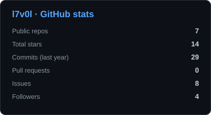
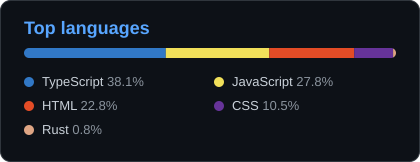

 

**English** · [العربية](README.ar.md)

 

---

## 👨‍💻 About Me | نبذة عني

- 👋 **Name | الاسم:** l7v0l
- 🌐 **Web development** and programming in many languages
- 🗣️ **Speaks | أتحدث:** English 🇬🇧 · العربية 🇸🇦
- 🌱 Constantly learning and improving
- ⚡ أحوّل القهوة إلى كود ☕

> مطوّر ويب، أبرمج بعدة لغات برمجة، وأحب بناء مشاريع عملية.

## 🔭 Working on now | أشتغل عليه الآن

<!--NOW:START-->
| Project | Last commit | When |
|:--|:--|:--|
| [**Assistix**](https://github.com/l7v0l/Assistix) | Add Render free-tier deployment (Dockerfile, render.yaml, health check) | 6d ago |
| [**lumen-vault**](https://github.com/l7v0l/lumen-vault) | README: Android download | 7d ago |
| [**drift-browser**](https://github.com/l7v0l/drift-browser) | docs: add issue templates | 7d ago |
| [**hawwil**](https://github.com/l7v0l/hawwil) | docs: add contributing guide, issue and PR templates | 7d ago |
<!--NOW:END-->

## 💬 Ask me about | اسألني عن

- Web development: HTML, CSS, JavaScript, TypeScript, React
- Privacy-first tools that run fully in the browser
- Arabic (RTL) interfaces and Arabic text in PDFs
- Electron desktop apps

## 🤝 Open to collaborate on | أبحث عن تعاون في

- Open-source Arabic developer tools
- Browser-only utilities (PDF, images, files)
- Learning apps for Arabic speakers

## 🛠️ Tech Stack | التقنيات

## 🚀 Projects | مشاريعي

| المشروع | الوصف | الرابط |
|:--|:--|:--|
| 🌍 **Drift** | Browse light. متصفح سطح مكتب خفيف يدعم العربية (RTL) والإنجليزية · Electron + React + TypeScript | [الموقع](https://drift-browser.netlify.app) · [تحميل](https://github.com/l7v0l/drift-browser/releases/latest) · [الكود](https://github.com/l7v0l/drift-browser) |
| 💡 **Lumen** | Password, card and secure-note manager. Encrypted vault, PIN + biometric unlock, Google Drive backup, Arabic / English / Chinese · React + TypeScript + Tauri | [جرّبه](https://l7v0l.github.io/lumen-vault/) · [تحميل](https://github.com/l7v0l/lumen-vault/releases/latest) · [الكود](https://github.com/l7v0l/lumen-vault) |
| 🗂️ **حوّل (Hawwil)** | 16 أداة داخل المتصفح: PDF، HEIC، وورد، ضغط الصور، فيديو إلى صوت وعكسه، بدون رفع ملفات، عربي وإنجليزي | [جرّبه](https://l7v0l.github.io/hawwil/) · [الكود](https://github.com/l7v0l/hawwil) |
| 🗣️ **لسان (Lisan)** | تعلّم الإنجليزية من الصفر بالعربي: صوت واضح، صور لكل كلمة، تسجيل دخول وحفظ التقدم | [جرّبه](https://lisan-d3dc8.web.app) · [الكود](https://github.com/l7v0l/lisan) |
| 📊 **GitHub Insights** | يحلل أي حساب GitHub: لغات، نشاط، ومقارنة بين حسابين | [جرّبه](https://l7v0l.github.io/github-insights/) · [الكود](https://github.com/l7v0l/github-insights) |
| 🔐 **مولّد كلمات السر** | يولّد كلمات سر آمنة داخل المتصفح، عربي مع وضع فاتح وداكن | [جرّبه](https://l7v0l.github.io/password-generator/) · [الكود](https://github.com/l7v0l/password-generator) |
| 🌐 **Portfolio** | موقعي الشخصي بتصميم متحرك وبلغتين | [جرّبه](https://l7v0l.github.io) · [الكود](https://github.com/l7v0l/l7v0l.github.io) |

## 📊 GitHub Stats | إحصائيات

<table>
<tr>
<td align="center" valign="middle"></td>
<td align="center" valign="middle"></td>
</tr>
<tr>
<td align="center" colspan="2"></td>
</tr>
</table>

## 🐍 Activity | النشاط

## 📖 Guestbook | سجل الزوار

Leave a comment in the [Guestbook](https://github.com/l7v0l/l7v0l/issues/1). | اترك تعليقاً في [سجل الزوار](https://github.com/l7v0l/l7v0l/issues/1).

## 💡 Quote | اقتباس

<!--QUOTE:START-->
> _First, solve the problem. Then, write the code._ — **John Johnson**
<!--QUOTE:END-->

## 📫 Contact | تواصل معي

 

<!--STAMP:START-->
Auto-updated 2026-10-24
<!--STAMP:END-->

